<p align="center">
  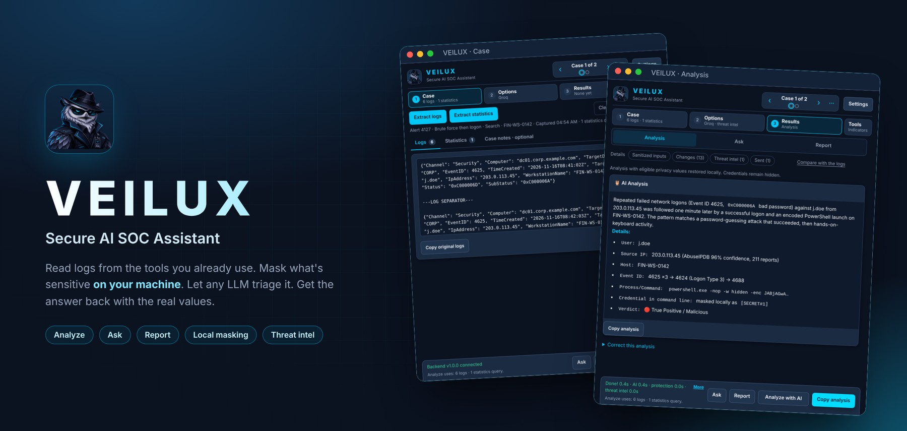
</p>

<p align="center">
  
  
  
  
  <br/>
  
  
  
  
  <br/>
  
  
  
  
  
</p>

<p align="center">
  <a href="#quick-start"><b>Quick start</b></a> ·
  <a href="#how-it-works"><b>How it works</b></a> ·
  <a href="#analyze-ask-report-one-case-three-actions"><b>Analyze · Ask · Report</b></a> ·
  <a href="#integrations"><b>Integrations</b></a> ·
  <a href="#features"><b>Features</b></a> ·
  <a href="#sanitization-controls-and-review"><b>Protection</b></a> ·
  <a href="#api-reference-backend"><b>API</b></a> ·
  <a href="#troubleshooting"><b>Troubleshooting</b></a>
</p>

---

**VEILUX** is AI-powered log analysis for SOC (Security Operations Center) analysts.

> 🧩 A **browser extension** captures logs from the security tools you already use (Splunk, Microsoft Sentinel and Defender, Elasticsearch, OpenSearch, Wazuh, QRadar, or any page or API), configured through analyst-editable **connections**, not hardcoded per platform.
>
> 🛡️ A **local backend** (run from Python source, or as a standalone app for Windows, Linux and macOS) masks the credentials and private values it detects before anything leaves your machine, sends the protected text to an LLM of your choice for triage,
>
> 🔁 then **re-hydrates** the AI's answer with the real values on your computer, so the AI provider works with placeholders instead of your real identifiers.

Works in Chrome, Edge, Brave, Opera and Vivaldi (version 121 or later) and Firefox (140 or later). See [Quick start](#quick-start) to be running in a few minutes, and [Testing in every browser](docs/BROWSER_TESTING.md) before a release.

<details>
<summary><b>📑 Contents</b></summary>

- [Quick start](#quick-start)
- [How it works](#how-it-works)
- [Analyze, Ask, Report: one case, three actions](#analyze-ask-report-one-case-three-actions)
- [A tour of the popup](#a-tour-of-the-popup)
- [Integrations](#integrations)
  - [Sign-in methods](#-sign-in-methods)
- [Features](#features)
- [Sanitization controls and review](#sanitization-controls-and-review)
- [Installation and setup](#installation-and-setup)
  - [Prerequisites](#prerequisites)
  - [1. Run the backend](#1-run-the-backend)
  - [2. Install the extension](#2-install-the-extension)
  - [3. Pair the extension with the backend](#3-pair-the-extension-with-the-backend)
  - [4. Configure API keys and sanitization rules](#4-configure-api-keys-and-sanitization-rules)
  - [5. Configure your connections](#5-configure-your-connections)
  - [Using it](#using-it)
- [Cases](#cases)
- [API reference (backend)](#api-reference-backend)
- [Tests](#tests)
- [Project structure](#project-structure)
- [Troubleshooting](#troubleshooting)
- [Detailed diagrams](docs/DIAGRAMS.md)
- [Changelog](#changelog) · [Security](#security) · [Contributing](#contributing) · [License](#license)

</details>

## Quick start

Three pieces work together: a **backend** on your computer, the **extension** in your browser, and a **connection** that tells VEILUX where your logs are.

| | Step | How |
|:-:|---|---|
| 1️⃣ | **Start the backend** | Download the standalone backend for your system (no Python needed), or run it from source. See [Run the backend](#1-run-the-backend). |
| 2️⃣ | **Install the extension** | Load the Chromium ZIP or Firefox XPI from a release, or the `extension/` folder from a clone. See [Install the extension](#2-install-the-extension). |
| 3️⃣ | **Pair them once** | The backend prints a code such as `K7QM-3XPA`. Enter it in the extension's **Settings → Backend** and choose **Pair**. |
| 4️⃣ | **Add an AI key and a connection** | **Settings → AI → Providers and keys**, then **Settings → Connections → Add a connection** and pick a [platform template](#integrations) (Splunk, Microsoft Sentinel, Defender, …) or describe your own source. |
| 5️⃣ | **Extract → Analyze** | Open a search, alert or incident page, click the VEILUX icon → **Extract**, then **Analyze**. |

<table>
<tr><th>📦 Release packages (no Python)</th><th>🐍 From source</th></tr>
<tr>
<td valign="top">

When a version is published, its packages are attached to this repository's **Releases** page:

| Package | For |
|---|---|
| `veilux-1.0.1-chromium.zip` | Chrome, Edge, Brave, Opera, Vivaldi |
| `veilux-1.0.1-firefox.xpi` | Firefox 140+ |
| `veilux-backend-1.0.1-windows-x64.zip` | Windows 10/11 x64 |
| `veilux-backend-1.0.1-linux-x64.tar.gz` | Linux x64, glibc 2.35+ |
| `veilux-backend-1.0.1-macos-x64.tar.gz` | macOS, Intel |
| `veilux-backend-1.0.1-macos-arm64.tar.gz` | macOS, Apple silicon |
| `SHA256SUMS.txt` | Checksums of every file |

Verify a download against `SHA256SUMS.txt` before running it.

</td>
<td valign="top">

```bash
git clone https://github.com/aymenmarjan/veilux-soc-assistant.git
cd veilux-soc-assistant
python3 -m venv venv
source venv/bin/activate        # Windows: venv\Scripts\activate
pip install -r requirements.txt
python server.py
```

Then load the `extension/` folder as an unpacked extension (Chromium) or a temporary add-on (Firefox).

Needs Python 3.12 or later.

</td>
</tr>
</table>

## How it works

```mermaid
%%{init: {"theme":"base","themeVariables":{"primaryColor":"#E6F7FD","primaryBorderColor":"#0C7AA6","primaryTextColor":"#0F2233","lineColor":"#5B7A99","clusterBkg":"#F4F9FC","clusterBorder":"#9FC9DC","titleColor":"#0F2233","edgeLabelBackground":"#FFFFFF"}}}%%
flowchart LR
    SIEM[("🗄️ Your security tools<br/>Splunk · Sentinel · Defender<br/>Elastic · QRadar · any page or API")]
    EXT["🧩 Extension<br/>reads logs through<br/>your connections"]
    PROT["🛡️ Local backend<br/>masks credentials<br/>+ private values"]
    AI{{"🤖 AI provider<br/>hosted or your own model"}}
    TI{{"🔎 Threat intel<br/>VirusTotal · AbuseIPDB · RDAP"}}
    RES["🛡️ Local backend<br/>restores real values<br/>secrets stay masked"]
    OUT(["✅ Results<br/>with the real values"])

    SIEM --> EXT -- "paired<br/>request" --> PROT
    PROT -- "⟦USER#1⟧ ⟦IP#1⟧<br/>placeholders only" --> AI
    PROT -. "public IOCs only" .-> TI
    AI -- "answer with<br/>placeholders" --> RES --> OUT

    classDef local fill:#0B1220,stroke:#00C8F8,color:#F1F5F9,stroke-width:1.5px
    classDef ext fill:#E6F7FD,stroke:#0C7AA6,color:#0F2233
    classDef out fill:#FFF4E5,stroke:#E8920C,color:#3D2600,stroke-width:1.5px
    classDef ok fill:#ECFDF3,stroke:#16A34A,color:#0B3B1E,stroke-width:1.5px
    class PROT,RES local
    class EXT ext
    class AI,TI,SIEM out
    class OUT ok
```

| | Step | What happens |
|:-:|---|---|
| 1️⃣ | **Read** | The extension matches the active tab against your connections and reads the logs the way that connection describes: a table or JSON on the page, an API request built from values on the page, or your own extraction script. |
| 2️⃣ | **Mask** | The backend detects credentials and masks them, then (with privacy masking on) swaps usernames, IPs, hostnames, domains, emails, and any custom keywords/JSON keys you configure for placeholders like `⟦USER#1⟧`. |
| 3️⃣ | **Ask the AI** | The protected text is sent to the AI provider you selected, along with a structured Tier-2-analyst prompt. |
| 4️⃣ | **Restore** | The AI's answer comes back with placeholders still in it; the backend swaps them back to the real values on your computer. Credentials stay masked, and the provider only ever received the placeholders for the values VEILUX detected. |

<sub>A more detailed version of this flow, with the extension's internals, is in [Detailed diagrams](docs/DIAGRAMS.md#1-full-data-flow).</sub>

## Analyze, Ask, Report: one case, three actions

<p align="center">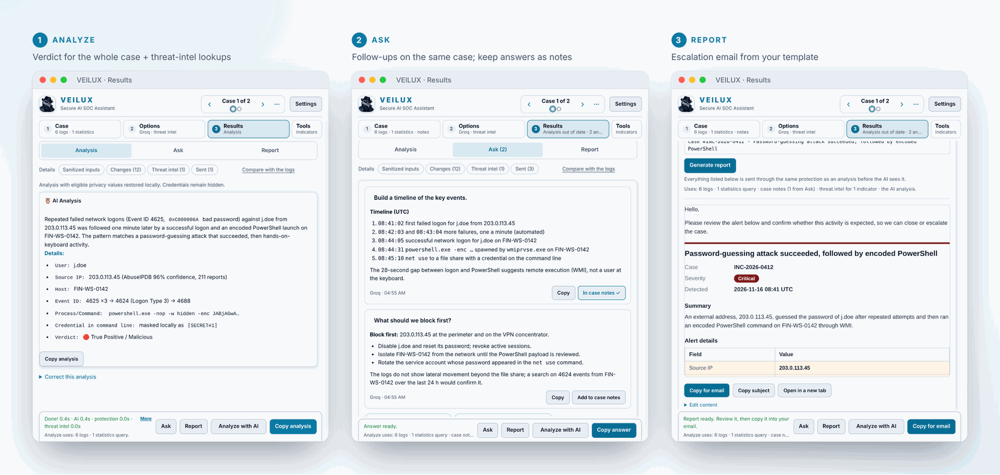</p>

Each case is a small investigation with **one shared memory**: its logs, its statistics and its **case notes**. Three actions work on that memory, and they are built on **the same protected request**, so a question or an email gets exactly the same protection as an analysis, the same placeholders, and the same record of what was sent.

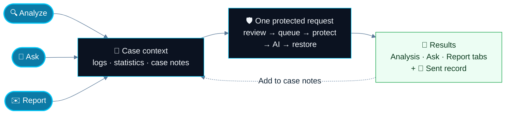

<sub>Threat-intelligence lookups run for **Analyze** only; Ask and Report reuse the results already in the case instead of looking indicators up again.</sub>

### What each action receives

| | 🔍 **Analyze** | 💬 **Ask** | ✉️ **Report** |
|---|:-:|:-:|:-:|
| Instructions | the analysis prompt you selected | built-in senior-analyst instructions | your template's instructions + answer format |
| Logs · statistics · case notes | ✅ | ✅ | ✅ |
| Approved lessons (10 most recent) | ✅ | ✅ | ✅ |
| Earlier AI analysis | – | ✅ as background | ✅ as background, never repeated as a section |
| Threat intelligence | **looked up** (popup switches) | reuses the case's results | reuses them as background only, never listed |
| Conversation | – | last 8 exchanges + the new question | never: only answers you kept, stated as findings |
| Extra | – | – | instructions for the email typed in the Report tab |
| Model | provider chosen in Options | per question (*Same as analysis* by default) | provider chosen in Options |
| Writes | analysis, TI findings, a fingerprint of the inputs | the conversation | the report (edit and re-render without a new AI request) |

Reports and answers always need an AI provider, even when the case is set to sanitize only. The popup says what each action will use before you click: under each action a **Uses:** line, for example `Analyze uses: 12 logs · 1 statistics query · case notes (2 from Ask)`.

### How the three feed each other

- **Analyze → Ask / Report.** The analysis and its threat-intelligence findings become background for every later question and report on the case (the logs remain the source of truth).
- **Ask → Case notes → everything.** **Add to case notes** keeps an answer as a note. From then on analyses, later questions and reports all use it, and it outlives the conversation. The analysis itself never reads the raw conversation, only the notes you kept.
- **The case knows when it changed.** When logs, statistics or notes change after an analysis, the Analysis tab says what changed and offers **Re-analyze**.
- **Reports speak with one voice.** Notes kept from Ask reach the report as findings of the case, never as a chat or a conversation.
- **Work continues in the background.** Requests run in the background worker, one job per case, so closing the popup does not cancel them. Analyses of different cases run side by side (3 at once by default; the rest queue), every result is written only to the case that started it, and answers that finish while the popup is closed are shown the next time the case is opened.
- **Every action is recorded** in the **Sent** tab with its purpose: Analysis, Ask or Email report.

<table>
<tr>
<td width="50%">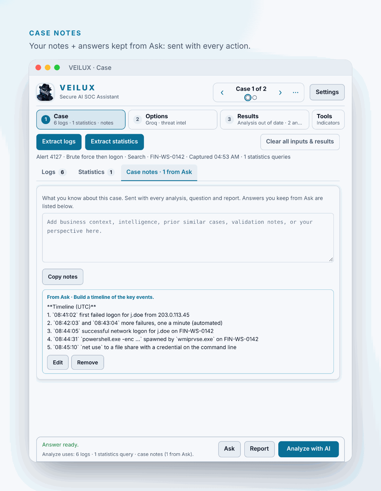</td>
<td width="50%">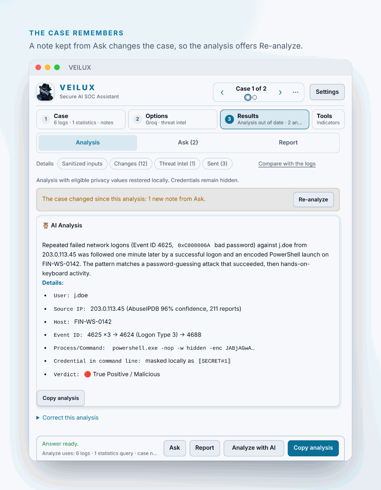</td>
</tr>
</table>

<sub>Diagrams of [how the three actions feed each other](docs/DIAGRAMS.md#2-how-analyze-ask-and-report-feed-each-other) and of [a question, step by step](docs/DIAGRAMS.md#3-a-question-step-by-step) are in Detailed diagrams.</sub>

## A tour of the popup

<p align="center">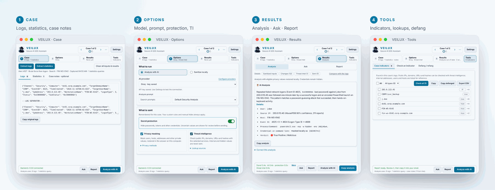</p>

**Several pasted logs**: separate them with a `---LOG SEPARATOR---` line (or press **Insert log separator** under the log box). The log count, statistics and the analysis then treat each part as its own log.

**A popup that shows one thing at a time**: a rail under the header switches between **Case** (logs, statistics and case notes as tabs), **Options** (what to run and what is sent), **Results** (Analysis, Ask and Report, with details such as sanitized inputs, changes, threat intel and the sent record one row below) and **Tools** (indicator check, defang). Each stage shows a one-line summary in the rail. A credential review takes over as its own stage until you answer it, and finished work opens Results by itself.

<p align="center">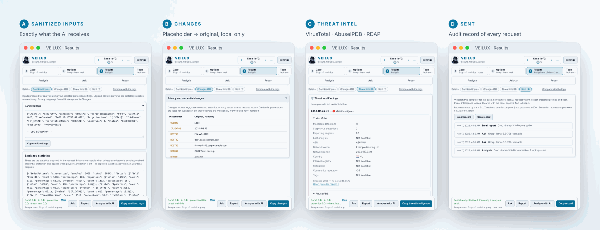</p>

<sub>Every screenshot in this README is the real extension and backend, run against synthetic logs (documentation IP ranges, `example.com` names, invented users) with every outside service mocked.</sub>

## Integrations

VEILUX reads from any product that shows logs as a table or JSON on a page, or answers a JSON API. **Platform templates** fill in a connection for common SIEM and XDR platforms; every value they write stays visible and editable in the connection form, and your edits are not overwritten when the extension updates.

<table>
<tr>
<td width="50%" valign="top">

#### 🟢 Splunk

- **Results of the search on screen**: reads the search you are viewing (the `sid` in Splunk Web's address) from the REST API in pages of 100, or the results table on screen when there is no `sid`.
- **Run a search (SPL)**: runs the default search, or one typed in the popup, as a search job (create → poll until `DONE` → paged results). Splunk's own error messages are shown when a search fails.
- **Sign-in:** a token (`Bearer <token>`) or username and password, on the management port (usually `8089`).

</td>
<td width="50%" valign="top">

#### 🔷 Microsoft Sentinel and Defender

- **Sentinel / Azure Monitor Logs: KQL query** in one Log Analytics workspace. Partial results are kept, with the service's warning shown next to them.
- **Sentinel: incident and its alerts**, opened in the Azure portal (Azure Resource Manager).
- **Defender portal: incident and its alerts** with their evidence (Microsoft Graph), including Sentinel incidents once the workspace is connected to the Defender portal.
- **Sign-in:** app sign-in with OAuth 2.0 client credentials (a Microsoft Entra ID app registration), or a pasted Bearer token.

</td>
</tr>
</table>

| Platform | Template | What it reads | Sign-in |
|---|---|---|---|
| **Splunk** | Results of the search on screen | `GET /services/search/v2/jobs/<sid>/results` (older versions: change the path to `/services/search/jobs/<sid>/results`) | Token or username/password |
| **Splunk** | Run a search (SPL) | Search job with a form body, polled until `dispatchState` is `DONE`, paged results | Token or username/password |
| **Microsoft Sentinel** | KQL query (Azure Monitor Logs) | `POST api.loganalytics.azure.com/v1/workspaces/<id>/query` | App sign-in (**Log Analytics Reader**) or Bearer token |
| **Microsoft Sentinel** | Incident and its alerts (Azure portal) | `…/Microsoft.SecurityInsights/incidents/<id>` and its alerts | App sign-in (**Microsoft Sentinel Reader**) or Bearer token |
| **Microsoft Defender portal** | Incident and its alerts (Microsoft Graph) | `graph.microsoft.com/v1.0/security/incidents/<id>` with its alerts | App sign-in (**SecurityIncident.Read.All**) or Bearer token |
| **Elasticsearch · OpenSearch · Wazuh indexer** | Search | `POST /<index>/_search`, Lucene query string, last 24 hours, newest first, pages of 100 | Username/password, or an `ApiKey` header for Elasticsearch |
| **Elasticsearch · OpenSearch · Wazuh indexer** | Document from Discover | `GET /<index>/_doc/<id>` from a Discover document link; otherwise the Inspector panel's search | Username/password or `ApiKey` |
| **OpenSearch Dashboards · Wazuh dashboard** | Browser login | Documents from `#/doc/` links and Discover searches through the Inspector panel | Your browser login |
| **IBM QRadar** | Offense and its events | The offense, then an Ariel search job limited to the offense's time range; the Log Activity table otherwise | Browser login, or an Authorized Service token |
| **Anything else** | Your own connection | A page table, page JSON, an Inspector panel, a JSON API (immediate or search job) or your own page script | Any [sign-in method](#-sign-in-methods) |

Ticketing or case-management pages can feed any of these: a connection can [collect record links from another page](docs/CONNECTOR_SETUP.md#4-request-values), such as a ticket, and fetch each linked record.

<details>
<summary><b>🔷 Connecting Microsoft Sentinel or Defender with an app registration</b></summary>

1. In **Microsoft Entra ID**, register an app and create a client secret.
2. Grant it what the template needs: the **Log Analytics Reader** role on the workspace (KQL query), the **Microsoft Sentinel Reader** role (Sentinel incident), or the **SecurityIncident.Read.All** application permission on Microsoft Graph (Defender incident; application permissions need an administrator's consent).
3. In the template, replace `YOUR-TENANT-ID` in the token address `https://login.microsoftonline.com/<tenant>/oauth2/v2.0/token` (and `YOUR-WORKSPACE-ID` for the KQL template), then enter the client ID and secret. The template already sets the scope: `https://api.loganalytics.io/.default`, `https://management.azure.com/.default` or `https://graph.microsoft.com/.default`.
4. Open a matching page and use **Preview extraction**, then **Save connection**.

Microsoft is moving Microsoft Sentinel into the Defender portal; for workspaces already there, use the Defender template.

</details>

> [!NOTE]
> Each template follows the vendor's public API reference and is tested against mock APIs that follow it ([tests/test_platform_templates.py](tests/test_platform_templates.py)). The project has not tested the templates against live deployments: API versions, permissions and data differ, so use **Preview extraction** before relying on one. The [connection setup guide](docs/CONNECTOR_SETUP.md#platform-templates) lists what each template requests, what you provide and what to check.

### 🔐 Sign-in methods

Each connection signs in to its platform in one of these ways:

| Method | Use it when | How VEILUX handles it |
|---|---|---|
| **Use my current browser login** (default) | You are signed in to the platform in this browser | Reads run in the signed-in tab when possible, so the browser sends its own cookies. **Send login cookies as headers** covers platforms that expect a cookie repeated as a header, such as QRadar's CSRF token. |
| **API key or access token** | You have a token | Sent as a header; include any prefix such as `Bearer` or `ApiKey`. |
| **App sign-in (OAuth 2.0 client credentials)** | The API issues tokens to a registered app, such as a Microsoft Entra ID app registration | The backend requests an access token from the token address you enter (client ID, client secret, scope), keeps it in memory only, renews it two minutes before it expires or after the API rejects it, and sends it as `Authorization: Bearer`. The client secret is sent only to a verified `https://` token address, and settings exports leave it out unless you choose to include keys. |
| **Username and password** | The API accepts basic authentication | Sent by the backend. |
| **One named browser cookie** | The API needs exactly one session cookie | Sent by the backend. |
| **No sign-in needed** | The API is open | – |

Token, password, app sign-in and named-cookie connections, search jobs and context requests always run through the local backend. Interactive OAuth sign-in (authorization code or device code) and refresh tokens are not supported. Access to the backend itself is separate: the extension proves itself with a key it receives at [pairing](#3-pair-the-extension-with-the-backend).

## Features

### 🗂️ Investigate

- **Several cases at once**: the popup holds 2 to 5 numbered cases (Settings → Cases). Each case keeps its own logs, statistics, case notes, choices, review decisions and results between openings. Switch with ‹ › in the header; dots show which cases are working, queued or have new results. Archived cases stay available, read-only, until you delete them. See [Cases](#cases).
- **Case notes: one memory for the whole case**: your own text plus answers kept from Ask, sent with every analysis, question and report and protected like the logs. See [how the three actions feed each other](#how-the-three-feed-each-other).
- **Case names and private notes**: the case's ⋯ menu gives it an optional name, shown next to its number, and a private notes field for ticket links or to-dos. Private notes stay on this computer and are never sent, unlike Case notes, which every AI request receives.
- **Case indicators**: Tools → **Case indicators** lists every IP, domain, URL, hash, email, user, host and SID found in the case's logs, with counts and a type filter. Check all of them, or the selected ones, with threat intelligence (only public IPs, domains, URLs and hashes are sent; results join the case's threat intelligence, so the Threat intel tab, Ask and reports use them), copy them defanged, or export them as CSV.
- **Defang/refang** helpers for sharing IOCs safely: `https://www.google.com/` becomes `hxxps://www[.]google[.]com/`, IPs become `203[.]0[.]113[.]45`, e-mails `admin[@]example[.]com`; paths, file names such as `cmd.exe` and the original evidence are left unchanged, and refang restores the exact original.

<table>
<tr>
<td width="50%">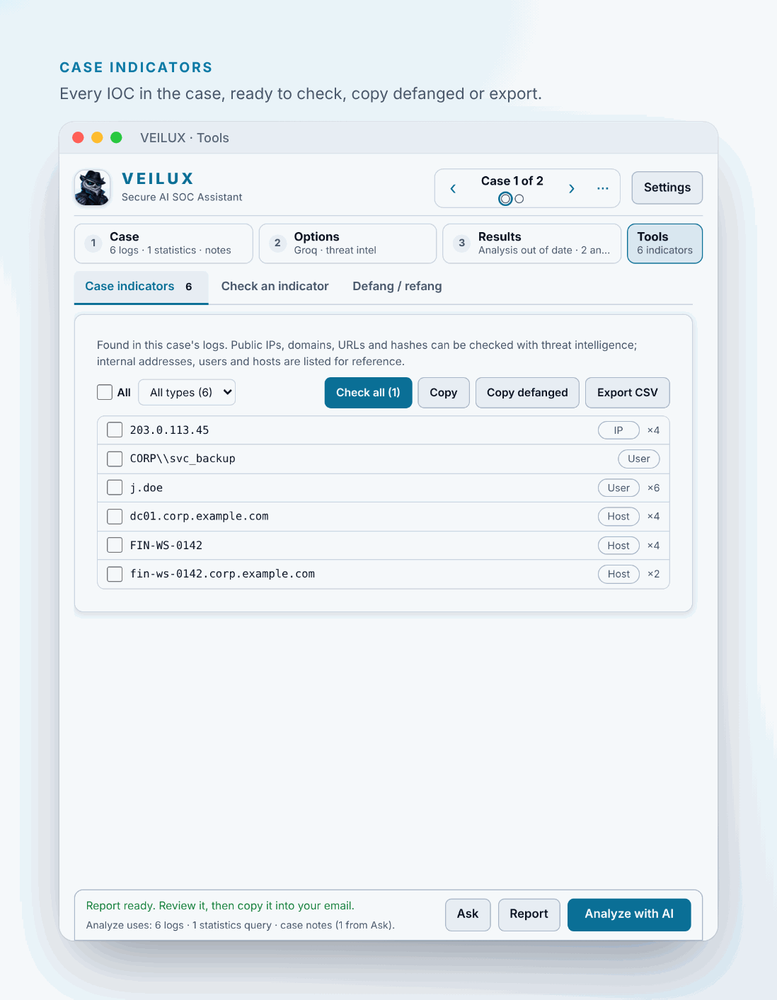</td>
<td width="50%">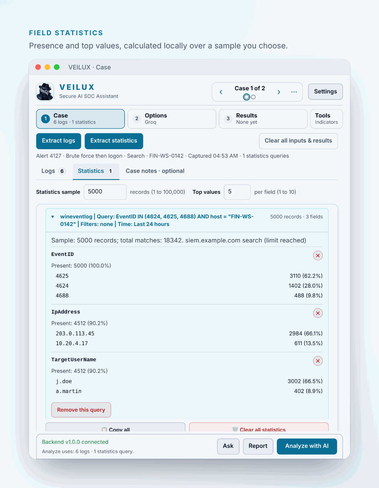</td>
</tr>
</table>

### 🤖 AI

- **Multi-provider AI analysis**: Groq, DeepSeek, Together AI, OpenRouter, Gemini, Claude. Pick per-request.
- **Choose the model yourself**: VEILUX has no built-in model IDs, because providers retire them. In Settings → Providers and API keys, **Load models** lists the models your key can use right now (only the key is sent, never logs); pick one, or enter a model ID. If the provider later retires it, the analysis stops with a clear message instead of switching to another model. **Test All APIs** checks each key and the chosen model the same way, without sending a prompt.
- **OpenRouter free models**: in Settings → AI models, or under the provider in the popup, choose **Find free models** to see the models OpenRouter offers for free right now (context window, longest answer, input types, reasoning, tool use, availability date and description), then **Use this model**. Any other OpenRouter model ID can be entered too.
- **Add your own model** in Settings → AI models → Your AI models: services speaking the OpenAI-compatible Chat Completions, Anthropic Messages, or Gemini GenerateContent API shape, including local runners such as Ollama and LM Studio. Choose a service, enter its exact model ID and key, then **Test connection** and **Save model**. Connection tests and analysis use the same configuration. See [your own AI models](docs/CUSTOM_MODELS.md).
- **Ask: follow-up questions per case**: an **Ask** tab next to Analysis and Report holds a short conversation about the open case, no analysis needed first. Each question resends the whole case plus the last 8 exchanges through the same protection, in one request, so markers stay consistent. Choose a model per question, start from quick questions (edited in Settings → Prompts), keep useful answers with **Add to case notes**, and clear the conversation with **Start over**.
- **Email reports**: turn a case into an escalation email with your own templates (HTML, severity scale with colours, subject pattern, AI instructions, language), managed in Settings → Email reports. The AI receives the whole case through the same protection as an analysis, no prior analysis needed; copy the result straight into your mail client. See [email report templates](docs/REPORT_TEMPLATES.md).
- **Approved lessons**: correct the AI's output and the correction is saved as a pending lesson. Approve, edit or delete lessons in Settings → Lessons; the 10 most recent approved lessons guide every new analysis.

### 🛡️ Protection

- **Layered local secret protection**: ten built-in credential-detection mechanisms behind one default-on switch, from recognizable provider tokens and private-key blocks to headers, URL credentials, command arguments, heuristics and bounded decoding. Credential protection stays on independently of the optional IP/user/domain privacy switches. See [One switch for secret protection](#-one-switch-for-secret-protection).
- **Minimal credential review**: high-confidence credentials are masked automatically; uncertain values (context-dependent `user:password` findings, GUID/hash shapes) are shown once per case in one compact review. See [Keep or Hide, once per case](#-keep-or-hide-once-per-case).
- **Granular sanitization**: automatic pattern detection (IPs, users, hosts, domains, emails) plus your own custom keywords and JSON-key filters, each independently toggleable.
- **Statistics-aware sanitization**: Settings can name statistic fields whose top values must be hidden before AI calls. Matching ignores case and punctuation (`Event_Ip`, `event-ip`, and `event_ip` are equivalent), and only that field's values are masked, not its counts, percentages, query, or neighboring fields. Statistic values keep their field context for privacy rules and credential detection, and the Sanitized tab and Changes include them. See [statistics protection](docs/STATISTICS.md).
- **Record of what was sent**: the **Sent** tab lists, per case, everything that left your computer: each AI request (provider, model, address, time, size and the exact protected prompt the provider received) and each threat-intelligence lookup (service, indicator, and whether it was sent or answered from the local cache), for analyses, reports, Ask questions and manual indicator checks. Requests that fail after sending are listed too, and runs that stayed local say so. API keys are never recorded. **Export record** saves it as JSON for audits; the record is cleared with the case. The backend builds the record from the requests it actually makes, and the tab warns when the backend address is not this computer.

### 🔌 Sources and connections

- **Guided connections**: a step-by-step editor asks where the logs are (a table on the page, JSON on the page, an API request, a search page's Inspector panel or your own script) and only shows the fields that answer needs. Pick a specific table from the open page in one click. For APIs, each `${value}` in the request comes from a clear source: the page address, links on a page, text or an attribute on a page, or a fixed value. A checklist flags values that have no source yet. See [connection setup](docs/CONNECTOR_SETUP.md).
- **Platform templates** for Splunk, Microsoft Sentinel, the Microsoft Defender portal, Elasticsearch / OpenSearch / Wazuh and IBM QRadar. See [Integrations](#integrations). **Test connection** checks a health path; **Preview extraction** checks the actual reader.
- **App sign-in with OAuth 2.0 client credentials**, alongside browser login, tokens, basic authentication and a named cookie. See [Sign-in methods](#-sign-in-methods).
- **Search-job APIs**: a second fetch mode for search APIs that run asynchronously (create a job → poll its status → fetch the results), started with URL parameters or a form body. VEILUX shows the platform's own reason when a search fails, reads paged results, and warns when an API returns partial results. These run through the local backend. An optional context request can fetch the record a search is about first, and its fields can limit the search, for example to that record's time range.
- **Linked records (optional)**: a connection can collect record links from another page, such as a ticket, and fetch each linked record without opening them one by one.
- **Page and API capture**: read rendered HTML tables or page JSON, a search page's Inspector panel, or a configured immediate/search-job JSON API. The connection's default search supplies the query, in your platform's own query language, through the configured query parameter or `${query}` placeholder. A trusted custom-script option remains available for unusual page interfaces.

### 📊 Statistics

- **Cross-platform field statistics**: Extract statistics summarizes the configured records, already captured logs, or the current search shown in an Inspector panel. Field presence and the most frequent values are calculated locally across a sample you choose in the popup (**Statistics sample**, 1 to 100,000 records, 5,000 by default; **Top values**, 1 to 10 per field, 5 by default). Statistics are read [in the background](#-extractions-in-the-background). Each query is a block that opens and closes, with the newest one open; **Collapse all** / **Expand all** handles several at once. Records that cannot be read (for example an event that answers 404) are left out and counted on the query, instead of stopping the statistics. Visible/API samples, limits and unknown totals are labelled.
- **Statistics-only analysis**: accumulated statistics can be analyzed without extracting individual events. The statistics panel also provides a one-click **Clear all statistics** action while retaining per-field and per-query removal controls.

### 🔎 Threat intelligence

- **Threat-intel enrichment, controlled per analysis**: toggle enrichment and each source (VirusTotal, AbuseIPDB, WHOIS/RDAP) directly in the popup. **WHOIS/RDAP needs no API key**: it's the free registry lookup that answers "who owns this IP range?" and "how old is this domain?", and a domain registered in the last 30 days is flagged suspicious on age alone. Registration data never produces a "clean" verdict; it only adds context.
- **Unified threat intelligence**: IOC enrichment examines both raw events and retained statistic top values, including statistics-only analyses. A shared deduplication pass looks up an IOC present in both sources only once; query/filter metadata is not mistaken for observed IOC evidence.
- **Structured IP and domain details**: provider cards show AbuseIPDB reports/ISP/usage/domain/country, VirusTotal ASN/network metadata, and free RDAP ownership/registration facts. Manual checks work without reputation keys when WHOIS is selected; source-aware caches and explicit missing/error states avoid stale successes and invented zero scores. See [setup, API limits and verification](docs/THREAT_INTELLIGENCE.md).

### 🎨 Interface

- **A popup that shows one thing at a time**: see [the tour](#a-tour-of-the-popup) above.
- **Organized Settings**: a sidebar groups everything by purpose. **Sources**: Connections, Extraction output. **AI**: Providers and keys, Your models, Prompts (analysis prompts and Ask quick questions), Lessons. **Protection**: Privacy masking, Custom rules, Credential detection, Threat intelligence. **Reports**: Email templates. **General**: Cases, Backend, Appearance, Backup and reset. **Custom rules** is one list for every hide, review and keep rule, matched by regex or by JSON field.
- **Light and dark themes**: light by default; switch to dark in **Settings → Appearance**.
- **Cross-browser**: one extension codebase for Chromium and Firefox.

<p align="center">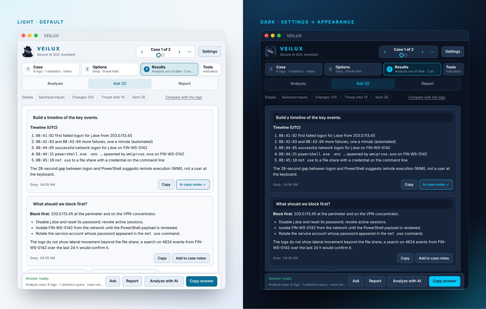</p>

## Sanitization controls and review

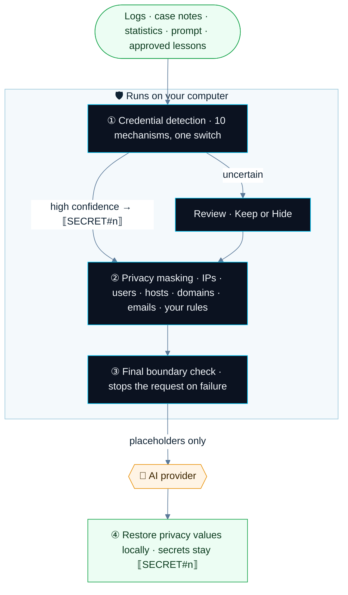

<sub>Threat-intelligence lookups (Analyze only) sit between ② and ③: only public IOCs are sent, credentials are blocked, and results are protected too. The [full pipeline diagram](docs/DIAGRAMS.md#4-full-protection-pipeline) shows every branch and time limit.</sub>

<table>
<tr>
<td width="42%" valign="top">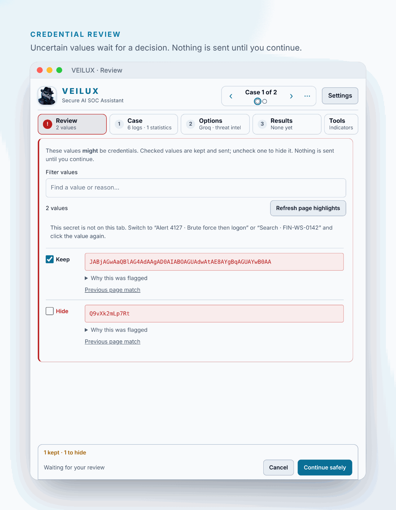</td>
<td valign="top">

#### 🔘 One switch for secret protection

The single **Secret protection** switch controls all ten built-in mechanisms: recognizable provider tokens, private-key blocks, authorization/cookie headers, URL and assignment credentials, command arguments, contextual candidates, heuristics, and bounded decoding. On enables every mechanism; Off disables every mechanism and shows a persistent notice. The switch is on by default, works in **Just Sanitize** mode, and persists across popup reopen. The API still supports individual mechanism configuration.

Manual hides and custom rules still apply independently. The privacy controls (Pattern-based, Custom Keywords and JSON Key Filtering) remain separate; turning optional privacy sanitization off does not disable enabled secret protection.

#### ✅ Keep or Hide, once per case

Uncertain credentials appear once per distinct value in one review panel, with **Keep checked by default** and an explicit Continue step. An analyst can keep a value, or select missed text and choose **Hide selected text**. Each value is asked about once per case: later analyses, reports and Ask questions on the same case reuse the decision and only show new values, for example from new logs, extra context or a new question. Decisions live in browser session storage and are cleared with the case or when the browser closes; they are never written to disk or saved as exemptions. Words from the fixed text VEILUX adds to report and Ask requests (such as the report's answer format) are never shown. Unchecking forces Hide; strong credentials cannot be kept.

</td>
</tr>
</table>

#### 🖍️ Highlights on the source page

Review values wrap in full and the list can be filtered. Matching text on the captured source page or a record it links to is highlighted yellow while review is open. Click a value to scroll to its next occurrence (orange), or use **Previous page match**. These controls do not change Keep/Hide. When a connection collects record links from another page, VEILUX also remembers those links: open a linked record in the same tab, a new tab, or another browser window to highlight and jump without extracting again. A pending review follows tab changes automatically. An unrelated page prompts you to switch back; the extension does not switch tabs for you. Source and linked URL metadata stays local and survives popup reopening.

<details>
<summary><b>Highlight limits and when highlights clear</b></summary>

Page counts cover exact, case-sensitive text currently rendered in accessible frames and open shadow roots; they can differ from counts in analysis inputs. Expand collapsed logs or load virtualized rows and use **Refresh page highlights** when a value is absent. API-only results, hidden fields, and closed shadow roots may have no displayed occurrence. Highlighting does not rewrite log text, change the page selection, or send values to a provider.

Highlights clear on Continue, Cancel, when the logs are edited or another tab is reviewed, when you press Esc on the page, when the page navigates, or after an hour. **They stay when the popup closes**, which happens whenever you click the page to look at a value: the review is saved with the case for this browser session, and the popup offers **Continue review** (your Keep/Hide choices are kept) or **Drop it** (which also removes the highlights) the next time it opens.

Page display work is bounded to 2 million characters, 100,000 DOM nodes and 10,000 matches per frame, with an explicit notice when limited; this never truncates or changes the actual secret scan or protection.

</details>

#### 🔒 Checks at every boundary

Changes to text or secret controls during review trigger a fresh preflight. The backend uses the same `secret_protection` object before IOC extraction, on TI content, and on the final AI prompt. It never silently re-enables a disabled mechanism. Final checks include edited previews, notes, custom prompts and saved approved lessons incorporated into the prompt. Recognized secrets are also hidden at other exact, case-sensitive value boundaries, including logical JSON escape equivalents. GUID/hash shapes and unusual tokens remain uncertain rather than confirmed secrets. The current thresholds, inventory limits, and typed restoration contract are in [the local policy catalog](docs/SECRET_RULE_CATALOG.md).

#### ✂️ Hide selected text

To hide a missed value, select it in Captured Logs, Case notes, or either editable sanitized preview, then click **Hide selected text**. Every exact, case-sensitive occurrence is replaced immediately in the current fields/previews (and any existing report), with a replacement count and **Undo**. Counts include each displayed copy. Manual Hide overrides an earlier Keep. Undo removes that manual rule and restores its markers without discarding unrelated edits; enabled detectors may still mask the value. Rules survive preview-to-send and popup reopen using browser session storage where supported. **Clear** starts a new analysis and clears these rules; they are never saved as permanent preferences. Editing a sanitized preview makes it the input for the next send; editing the corresponding raw field returns control to that field.

#### 🧪 Just Sanitize

**Just Sanitize** uses only the local backend and never invokes AI or TI, even if TI is checked. Progress distinguishes local sanitizing, waiting for review, checking TI, and waiting for AI. Completion shows detection, replacement, optional privacy masking, review, TI and AI durations separately (only applicable stages are listed). There is no credential verification over the network.

#### ⏱️ Time limits and Cancel

| Stage | Limit |
|---|---|
| Local scan / sanitization | 10 seconds plus 15 seconds per MB, up to 15 minutes |
| Secret scanning | up to 2 million characters per text |
| Threat intelligence | 45-second budget plus a short cleanup margin; individual lookups respect the remaining budget |
| AI | 180-second overall cap in addition to provider timeouts |

Oversized/failed/timed-out local work stops the request. **Cancel** cancels the backend task, including during slow TI; it cannot recall a request already sent. Closing the popup still allows the background analysis to finish. Local maps remain local and secret markers remain masked in reports.

#### 📥 Extractions in the background

Extract logs and Extract statistics also run in the background. Close the popup while a slow API or search job is working; the records or statistics are added the next time you open it, and the toolbar badge shows when they are ready. **Cancel** stops the job before its next request. Only one extraction runs at a time. After updating the extension files, reload the extension (`chrome://extensions`, or `about:debugging` in Firefox): until then the browser keeps the previous background worker, and extractions run in the popup instead, which must stay open.

A larger statistics sample needs the connection to return that many records: an API connection must read several pages (step 3, *Read several pages of results*), and some search APIs refuse to page past a fixed limit (often 10,000 records).

> [!WARNING]
> Detection is pattern- and context-based. An arbitrary secret with no recognizable format, label, or nearby authentication context may not be detected; review the **Sanitized** preview before sending, and use **Hide selected text** for anything VEILUX missed. Secret placeholders deliberately remain masked in final reports, and their restoration map never leaves the local backend/extension workflow.

## Installation and setup

The [Quick start](#quick-start) above is the short version; this section covers each step in full.

### Prerequisites

- 🖥️ **Backend**: nothing to install with a standalone package (Windows 10/11 x64, macOS Intel or Apple silicon, Linux x64 with glibc 2.35+), or **Python 3.12 or later** to run from source.
- 🌐 **Browser**: Chrome, Edge, Brave, Opera or Vivaldi 121+, or Firefox 140+.
- 🔑 **AI access**: an API key for at least one provider you want to use (Groq, DeepSeek, Together, OpenRouter, Gemini, and/or Claude), or your own OpenAI-compatible, Claude or Gemini endpoint, including a local runner such as Ollama or LM Studio.
- 🔗 **Network access** from your machine to the security tools you read logs from.

### 1. Run the backend

The backend starts on `http://localhost:8000` and, by default, only accepts connections from your own computer. Leave it running: the extension talks to it for analysis, protection, threat intel and API reads. Check it's healthy anytime at `http://localhost:8000/health`.

#### Option A: standalone backend (no Python needed)

Download the package for your system from a published release and check it against `SHA256SUMS.txt`: `sha256sum <file>` (Linux), `shasum -a 256 <file>` (macOS) or `Get-FileHash <file> -Algorithm SHA256` (Windows PowerShell). Each package includes `HOW-TO-START.txt`.

<table>
<tr><th>🪟 Windows x64</th><th>🍎 macOS (Intel · Apple silicon)</th><th>🐧 Linux x64</th></tr>
<tr>
<td valign="top">

Extract the ZIP anywhere you can write to, then double-click `veilux-backend.exe`. Keep the console window open.

</td>
<td valign="top">

Extract the archive, then in Terminal, in the extracted folder:

```bash
./veilux-backend
```

</td>
<td valign="top">

```bash
tar -xzf veilux-backend-1.0.1-linux-x64.tar.gz
./veilux-backend-1.0.1-linux-x64/veilux-backend
```

</td>
</tr>
<tr>
<td valign="top">Data: <code>%LOCALAPPDATA%\VEILUX</code></td>
<td valign="top">Data: <code>~/Library/Application Support/VEILUX</code></td>
<td valign="top">Data: <code>~/.local/share/veilux</code> (<code>$XDG_DATA_HOME/veilux</code>)</td>
</tr>
</table>

The data folder holds the backend key (readable only by your account), your lessons and the threat-intelligence cache; `VEILUX_DATA_DIR` sets another folder. Stop the backend with **Ctrl+C**. Use `--port 8100` for another port and `--version` to print the version.

> [!NOTE]
> If a build is not code-signed, Windows SmartScreen asks you to choose **More info → Run anyway**, and macOS blocks the first start until you clear the quarantine flag (`xattr -dr com.apple.quarantine .` in the extracted folder). Do either only for a file downloaded from the official VEILUX release whose checksum matches.

#### Option B: from source

```bash
git clone https://github.com/aymenmarjan/veilux-soc-assistant.git
cd veilux-soc-assistant
```

<table>
<tr><th>🪟 Windows</th><th>🍎 macOS / 🐧 Linux</th></tr>
<tr>
<td>

```bash
python -m venv venv
venv\Scripts\activate
pip install -r requirements.txt
python server.py
```

</td>
<td>

```bash
python3 -m venv venv
source venv/bin/activate
pip install -r requirements.txt
python server.py
```

</td>
</tr>
</table>

Run from source, the backend keeps its key (`veilux_backend.key`), lessons and cache in the folder you start it from, and `.gitignore` keeps them out of Git. To use another port, start it with `python server.py --port 8100` (or set `VEILUX_PORT`).

<details>
<summary><b>🌐 Sharing the backend on a network</b></summary>

Pairing codes work only on the computer running the backend. For other computers, set the key yourself and enter it in **Settings → Backend → Backend key** on each of them:

```bash
export VEILUX_TOKEN="$(python -c 'import secrets; print(secrets.token_urlsafe(32))')"   # Windows PowerShell: $env:VEILUX_TOKEN="..."
python server.py --host 0.0.0.0
```

`VEILUX_TOKEN` must be at least 16 characters, or the backend does not start. If other computers reach the backend under a name, list it: `VEILUX_ALLOWED_HOSTS=soc-box.internal` (a name given with `--host` is added automatically). A reverse proxy on this computer counts as another computer as long as it adds a `Forwarded` or `X-Forwarded-For` header, which Caddy, Traefik and most nginx examples do. The backend serves plain HTTP, so across a network use a trusted network or a TLS reverse proxy.

</details>

| Environment variable | Purpose |
|---|---|
| `VEILUX_PORT` | Port to listen on (same as `--port`) |
| `VEILUX_DATA_DIR` | Folder for the key, lessons and cache |
| `VEILUX_KEY_FILE` | Where the backend key is stored (default `veilux_backend.key` in the data folder) |
| `VEILUX_TOKEN` | Set the key yourself for other computers (at least 16 characters) |
| `VEILUX_ALLOWED_HOSTS` | Extra host names the backend answers to |
| `VEILUX_ALLOWED_ORIGINS` | Extra exact origins |
| `VEILUX_LOG_LEVEL` | `DEBUG`, `INFO`, `WARNING`: how much the backend prints |

### 2. Install the extension

Use the package from a release, or the `extension/` folder of a clone. Steps differ slightly per browser family.

#### Chromium browsers

From a release, extract `veilux-1.0.1-chromium.zip` first and select the extracted folder in step 3; from a clone, select the `veilux-soc-assistant/extension` folder.

| Browser | 1. Go to | 2. Turn on **Developer mode** | 3. Then |
|---|---|---|---|
| **Chrome** | `chrome://extensions` | top-right toggle | **Load unpacked** → select the extension folder → pin the extension (puzzle-piece icon → pin) for quick access |
| **Microsoft Edge** | `edge://extensions` | left sidebar toggle | **Load unpacked** → select the extension folder → pin it from the extensions toolbar icon |
| **Brave** | `brave://extensions` | top-right toggle | **Load unpacked** → select the extension folder |
| **Opera / Opera GX** | `opera://extensions` | top-right toggle | **Load unpacked** → select the extension folder |
| **Vivaldi** | `vivaldi://extensions` | top-right toggle | **Load unpacked** → select the extension folder |

Chromium-based browsers need version 121 or later. Always load the extension from the same folder path: its settings belong to that installation.

#### Firefox

**Temporary install** (for trying it out / daily dev use, removed when Firefox closes):

1. Go to `about:debugging#/runtime/this-firefox`.
2. Click **Load Temporary Add-on…**.
3. Select `veilux-1.0.1-firefox.xpi`, or any file inside `veilux-soc-assistant/extension` (e.g. `manifest.json`).
4. The extension is active until Firefox is closed; you'll need to repeat this each restart.

**Permanent install** (persists across restarts). Firefox installs extensions permanently only when Mozilla has signed them, even for internal/private use:

- **A signed XPI**: if the release provides a Mozilla-signed `.xpi`, install it from `about:addons` → ⚙ → **Install Add-on From File…**.
- **Sign it yourself for free** via [addons.mozilla.org](https://addons.mozilla.org/developers/) (choose "unlisted" distribution so it isn't published publicly), then install the signed `.xpi` the same way.
- **Use Firefox ESR/Developer Edition/Nightly** with `xpinstall.signatures.required` set to `false` in `about:config` (internal/enterprise use only; do not do this on a browser used for anything else).

The manifest declares a stable Firefox add-on ID (`browser_specific_settings.gecko.id`), the minimum version (Firefox 140, an ESR release) and the data-collection declaration addons.mozilla.org asks for. If the popup shows **Allow site access**, Firefox has site access switched off for VEILUX; click it, or enable it in `about:addons` → VEILUX → Permissions.

<details>
<summary><b>🧪 Safari (experimental, not yet supported)</b></summary>

Safari does **not** support loading an unpacked extension folder directly. Apple requires converting Web Extensions into a Safari extension inside a macOS app, which can only be built on **macOS with Xcode**:

1. On a Mac, install Xcode and the Xcode command line tools.
2. Run Apple's converter against the extension folder:
   ```bash
   xcrun safari-web-extension-converter /path/to/veilux-soc-assistant/extension
   ```
3. This generates an Xcode project wrapping the extension in a macOS app. Open it in Xcode and hit **Run** to build and install it.
4. In Safari, go to **Settings → Extensions** and enable "VEILUX".
5. You may also need **Settings → Advanced → Show features for web developers**, then **Develop → Allow Unsigned Extensions**, for local/unsigned builds.

The codebase uses the standard `browser.*` WebExtension API (see `extension/browser-polyfill.js`) and avoids Chromium-only APIs, which makes conversion possible. VEILUX has not yet been tested in Safari (background service worker, scripting, cookies and pairing), so treat a converted build as experimental.

</details>

### 3. Pair the extension with the backend

When it starts, the backend prints a pairing code:

```
🤝 Pairing code: K7QM-3XPA  (valid 15 minutes, on this computer)
```

Open the extension's **Settings → Backend**, enter the code and choose **Pair**. VEILUX stores the backend key and signs every request with it; the popup says so if a browser is not paired yet. Pair each browser once; a new code appears every time the backend starts. The key is created on first start, readable only by your user account. Delete the key file to create a new key; every browser then pairs again. If you changed the port, enter the address (for example `http://localhost:8100`) under **Settings → Backend → Backend address**; **Check backend** confirms the extension can reach it and is paired.

**🚪 Only the paired extension may call it.** Every request except `GET /health` and pairing must carry the backend key (`X-Veilux-Token`), so other browser extensions and programs that don't hold the key are refused, even on this computer. Web pages are refused earlier still: only extension origins (`chrome-extension://`, `moz-extension://`, `safari-web-extension://`) are answered, and requests from a browser must address the backend as `localhost`, `127.0.0.1` or `[::1]`, which stops a site from pointing its own domain at your computer (DNS rebinding). `VEILUX_ALLOWED_ORIGINS` adds exact origins. Your own scripts can call the API with the key from the key file. The [access-check diagram](docs/DIAGRAMS.md#5-backend-access-check) shows each step, and [SECURITY.md](SECURITY.md) explains what leaves your computer and how keys are stored.

### 4. Configure API keys and sanitization rules

Click the extension icon → **Settings**. The sidebar groups everything by purpose:

| Section | What to set |
|---|---|
| **AI → Providers and keys** | Paste the key for whichever provider(s) you plan to use, then **Load models** and choose a model for each built-in provider. Only the provider selected for an analysis needs a key. **Your models** adds any OpenAI-compatible, Claude or Gemini API ([guide](docs/CUSTOM_MODELS.md)). |
| **Sources → Connections** | See [step 5](#5-configure-your-connections) below. |
| **Protection → Privacy masking** | Auto-detects IPs, users, hosts, domains and emails, plus JSON keys and keywords you list (for example a project codename). |
| **Protection → Custom rules** | Your own regular expressions and field exclusions in one list. |
| **Protection → Credential detection** and **Threat intelligence** | VirusTotal and AbuseIPDB keys; WHOIS/RDAP needs none. |
| **General → Backend** | The backend address, and pairing with the backend (see [step 3](#3-pair-the-extension-with-the-backend)). |
| **Sources → Extraction output** | How several logs are joined when copied out (`separate logs` or `raw request`). |

Settings, API keys and connection credentials are kept in this browser's extension storage on this computer, not synced to your browser account. Like other extensions' settings they are not encrypted, so anyone with access to the browser profile can read them; a separate browser profile for SOC work is a good idea. **Export Settings** leaves keys and secrets out unless you choose to include them.

<p align="center">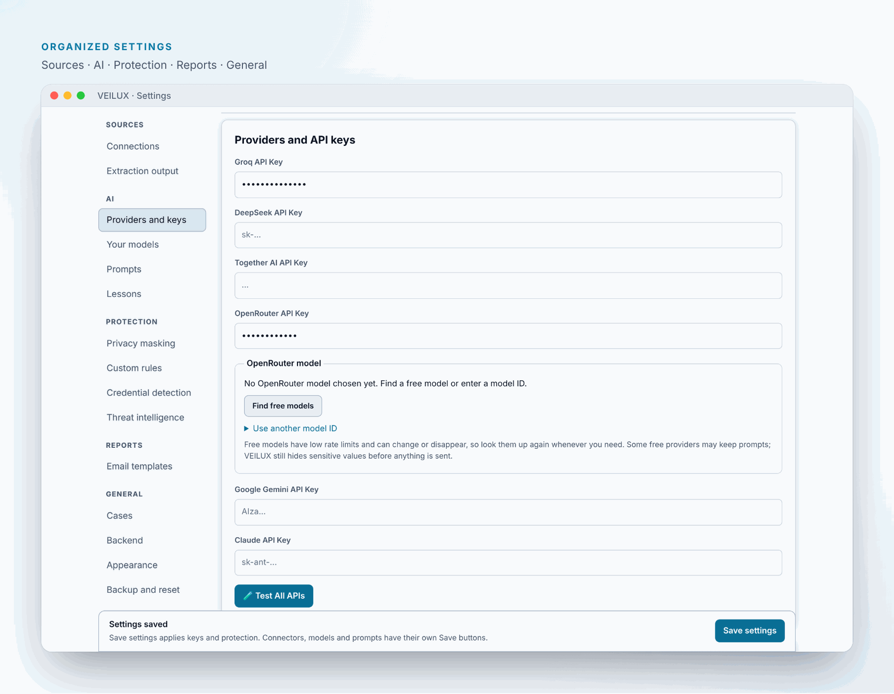</p>

### 5. Configure your connections

No code or manifest edits are needed. Everything platform-specific lives in **connections**, edited in the extension's Settings page (gear icon → **Connections** → **Add a connection**). New installations start with an empty list; a [platform template](#integrations) is the fastest start for Splunk, Microsoft Sentinel, the Defender portal, Elasticsearch / OpenSearch / Wazuh and QRadar.

The editor asks a few questions in order and only shows what your answers need:

1. **Basics**: an optional platform template, a name, and the website address you open in your browser.
2. **Where are the logs?** A table on the page, JSON shown on the page, an API request, a search page's Inspector panel, or your own page script. For tables, **Find tables on the open page** lets you pick one specific table.
3. **API request** (API only): address, path, query parameters and body with `${name}` placeholders, and where the records are in the JSON response (with a sample-response helper). Search-job APIs (create → poll → results) are supported.
4. **Request values** (API only): where each `${name}` comes from: **the page address**, **links on a page** (for example the record links on a ticket; one request per link), **text on a page**, **an element attribute**, or **a fixed value**. A checklist shows which values still have no source, and you choose what happens on pages without values (send the request anyway, or read a table / JSON / the Inspector panel instead).
5. **Sign-in** (API only): see [Sign-in methods](#-sign-in-methods).

**More options** holds page matching, record limits, statistics, where API requests run, and certificate settings (verification is on by default; a private CA can be added per connection). Use **Preview extraction** with a matching page open to check the result, then **Save connection**. See the [connection setup guide](docs/CONNECTOR_SETUP.md) for every option and more recipes, and the [editor flow diagram](docs/DIAGRAMS.md#6-connection-editor-flow).

<p align="center">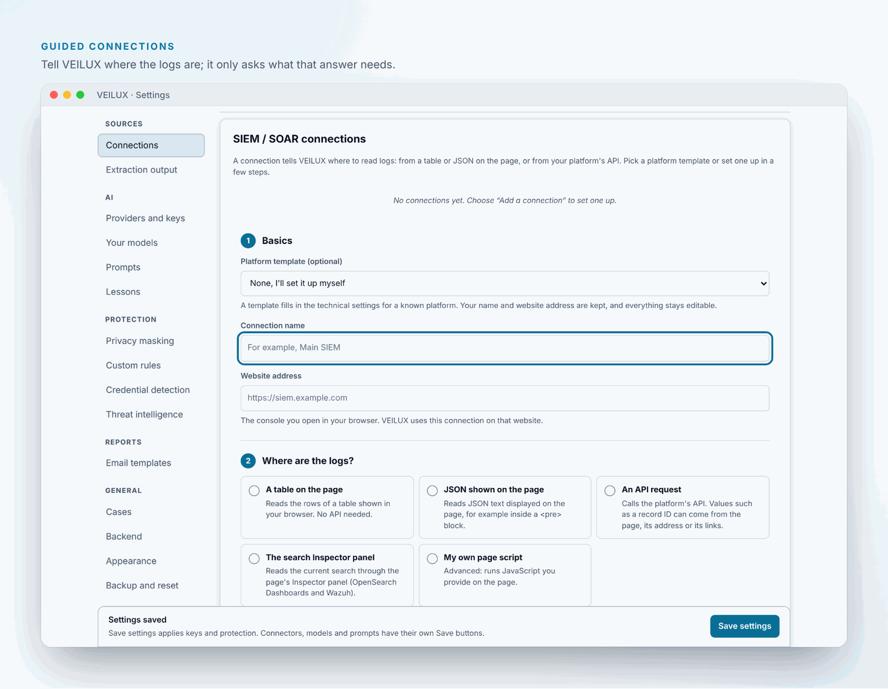</p>

#### Example: an API with search jobs

A fictional SIEM at `https://siem.example.com` opens alerts at `https://siem.example.com/alerts/<id>` and runs searches as jobs ([sequence diagram](docs/DIAGRAMS.md#7-search-job-sequence)):

1. **Add a connection**, name it and enter `https://siem.example.com`.
2. **Where are the logs?** *An API request*; under *How the API answers*, choose the search-job option and fill in the three steps: start the search (`POST /api/searches`), the job ID's location in the answer, the status address (`/api/searches/${job_id}`) with its finished value, and the results address (`/api/searches/${job_id}/results`).
3. **Request values**: *The page address* with the pattern `https://siem.example.com/alerts/{alert_id}`; use `${alert_id}` in the search.
4. **Sign-in**: *API key or access token*, or *App sign-in* if the platform issues tokens to registered apps.
5. Make sure the local backend is running: search jobs run through it. **Test connection**, then **Save connection**.
6. Open an alert and click **Extract**.

The [connection setup guide](docs/CONNECTOR_SETUP.md#platform-templates) lists what each platform template needs from you.

### Using it

1. 🌐 Open the page you want to extract from (a search results page, a single record or incident, or a page that links to records) for a connection you've configured.
2. 📥 Click the extension icon → **Extract**. It finds the connections that match the page and reads it the way the connection describes.
3. ✏️ Review/edit the extracted logs and optional case notes in the popup.
4. 🤖 Pick an AI provider (or "Sanitize only" to just see the sanitized output without calling any AI), then **Analyze**.
5. 🎓 Read the summary, details, and verdict. If the AI got something wrong, send a correction: it is saved locally as a pending lesson, and once you approve it in **Settings → Lessons** it guides future analyses of every case.

## Cases

Work on several investigations side by side. The popup header shows **‹ Case 1 of 2 ›**; each case is a separate page with its own:

- captured logs, statistics and case notes (your text and answers kept from Ask);
- choices: AI provider and OpenRouter model, prompt, sanitization and threat-intel switches, credential protection, statistics sample and top values;
- credential-review decisions and manually hidden values;
- results: analysis, sanitized inputs, changes and threat intel.

Everything is saved as you go and comes back when you reopen the popup, which opens on the last case you viewed. Settings (API keys, connections, keyword and JSON-key lists, regex rules, prompts) are shared by all cases. The [case lifecycle diagram](docs/DIAGRAMS.md#8-case-lifecycle) shows how a case moves between open, queued, running, new results and archived.

| | |
|---|---|
| **Switching** | ‹ › or a dot moves to another case. Extractions and analyses keep running in the background and land in the case that started them; the dots show each case's state (working, queued, new results, error) and the toolbar badge counts cases with results you have not opened yet. Switching waits only while this popup itself is busy (credential review or choosing a connection). |
| **Running at once** | Analyses of up to 3 cases run together by default (Settings → Cases → *Analyses running at once*, 1 to 5); others show *Queued* and start in order. |
| **New cases** | A new or freed slot starts empty but keeps the choices of the case you were viewing, like **Clear all inputs & results**. |
| **Archive** | The ⋯ menu archives the open case. Its slot starts a fresh case, and the archived one is listed as **A1, A2, …**, read-only: inputs and results can be read and copied, but nothing can be extracted, edited or sent. **Restore** puts it back into an empty slot; **Delete** (click twice) or **Clear archive** removes it for good. |
| **Slots** | Settings → Cases → *Case slots in the popup* (2 to 5). Lowering it archives cases that hold work and discards empty ones. |
| **Right-click window** | "Extract logs from this page" opens on the last case you viewed, with the same switcher. |

## API reference (backend)

| Endpoint | Purpose |
|---|---|
| `POST /analyze` | Sanitize (optional) + send to AI provider, return analysis with real values restored |
| `POST /sanitize` | Sanitize only, no AI call |
| `GET /analysis/{id}/status` · `POST /analysis/{id}/cancel` | Progress of a running analysis, or stop it |
| `POST /secrets/scan` | Find credential candidates for the review before anything is sent |
| `POST /indicators` | List the indicators (IPs, domains, URLs, hashes, emails, users, hosts) in a case's logs |
| `POST /threat-intel/lookup` | Look up one indicator with VirusTotal, AbuseIPDB and RDAP |
| `POST /fetch-siem-logs` | Generic, connector-template-driven log fetch. Supports `fetch_mode: "search_job"` for asynchronous search APIs (create → poll → results), every backend [sign-in method](#-sign-in-methods) including OAuth 2.0 client credentials, and an optional per-link context document. The extension's Extract flow calls this for backend connections; connections that use the browser login can read inside the signed-in tab instead. |
| `POST /test-siem` | Check SIEM connectivity via a connection's health-check path |
| `POST /defang` / `POST /refang` | Defang/refang IOC text |
| `POST /feedback` | Save an analyst correction as a pending lesson |
| `GET /lessons` · `PATCH /lessons/{id}` · `DELETE /lessons/{id}` | List lessons (text and status only), approve or edit one (edited text is protected again), or delete one |
| `GET /providers/openrouter/free-models` | Look up OpenRouter's current free text models with their details (no key needed, never cached) |
| `POST /pair` · `GET /auth/check` | Exchange the start-up pairing code for the backend key (this computer only) · confirm the key is right |
| `GET /health` | Backend health/version check |

> [!IMPORTANT]
> Every endpoint except `GET /health` and `POST /pair` needs the backend key in the `X-Veilux-Token` header (see [Pair the extension](#3-pair-the-extension-with-the-backend)). `POST /pair` exchanges the start-up pairing code for the key, on this computer only; `GET /auth/check` answers only when the key is right.

## Tests

```bash
pip install -r requirements-test.txt
python -m playwright install chromium
python -m pytest tests                          # backend and UI tests in Chromium
python tests/test_connectors.py                 # connector engine against a mock SIEM
for f in tests/test_*.js; do node "$f"; done    # extension modules in Node
# The UI tests in Firefox's engine, and the add-on lint (see docs/BROWSER_TESTING.md):
python -m playwright install firefox
VEILUX_TEST_ENGINE=firefox python -m pytest tests
cd tools/browser-check && npm ci && npm run check
```

> [!NOTE]
> No real SIEM, AI service or API key is needed: every external service is mocked.

- **Connector engine.** `tests/test_connectors.py` runs the connector engine against a mock SIEM: single-request lookups, search jobs (create → poll → results) with a context record, token-header and browser-session sign-in, and nested status fields. It also covers platform fingerprinting, error text surfaced from 401/403 bodies, template arithmetic that limits a search to a record's own time range, and the threat-intel time budget.
- **Platform templates.** `tests/test_platform_templates.py` runs every template against mock APIs that follow each vendor's API reference.
- **Credential suite.** It uses only synthetic values and covers raw/mixed logs, quoted values, URL credentials, headers and cookies, connection strings, command arguments, multiline private keys, contextual ambiguous pairs, legitimate GUIDs/hashes, overlap resolution, analyst edits, and both AI and TI outbound boundaries. Provider-prefix rules are locally embedded from the gitleaks 8.24.2 rule shapes; there is no network credential verification or runtime detector download.
- **Release packages.** The **Release packages** workflow (`.github/workflows/package.yml`) builds the extension packages and the four standalone backends, starts, pairs and stops each backend, pairs the built extension with it, and records SHA-256 checksums. See [packaging/PUBLISHING.md](packaging/PUBLISHING.md).

## Project structure

```
veilux-soc-assistant/
├── server.py               Backend (FastAPI): protection, AI calls, SIEM connector requests, threat intelligence
├── secret_detection.py     Offline credential detection (rules adapted from Gitleaks and Secretlint)
├── requirements.txt        Backend dependencies (requirements-test.txt adds the test tools)
├── extension/              The browser extension (Manifest V3, Chromium and Firefox)
│   ├── manifest.json
│   ├── popup.html, popup.js, popup_ui.js    The popup: Case, Options, Results and Tools stages
│   ├── settings.html, settings.js, ...      Settings, connection editor, report templates
│   ├── background.js, extraction_jobs.js    Background work that continues when the popup closes
│   ├── connector_*.js                       Connections: configuration, templates, page and API readers
│   ├── cases.js, cases_ui.js, ...           Per-case storage and the case switcher
│   └── icons/
├── packaging/              Builds the extension packages and standalone backends; publishing guide
├── tests/                  Backend, browser UI and Node tests (all external services mocked)
├── tools/browser-check/    Firefox add-on lint and web API compatibility check
├── .github/workflows/      Browser tests and release packages
└── docs/                   Guides: connections, reports, threat intelligence, credential rules, testing, diagrams
```

<details>
<summary><b>Where the Analyze · Ask · Report orchestration lives</b></summary>

| File | Role |
|---|---|
| `extension/popup.js` → `analyzeWithAI(task)` | The one protected request behind all three actions: case notes, credential review, payload, `START_ANALYSIS` |
| `extension/case_notes.js` | The case's shared memory, the **Uses:** lines and "The case changed since this analysis" |
| `extension/chat_panel.js` | Ask: instructions, context (earlier analysis, TI, last 8 exchanges), **Add to case notes** |
| `extension/report_panel.js` | Report: template instructions, case material, rendering and copying the email |
| `extension/background.js` | Queue (one job per case, *Analyses running at once*), progress, Sent record, routing results by purpose |
| `server.py` → `/analyze` | Protection, threat intelligence, final boundary check, AI call, restoring values |

</details>

## Troubleshooting

| Symptom | Fix |
|---|---|
| **"Backend not reachable"** | Make sure the backend is running (`veilux-backend` or `python server.py`) and that **Settings → Backend → Check backend** succeeds. The address there must match the port the backend prints when it starts. Search-job connections also fetch through the backend. |
| **Backend says the port is in use** | Another program (or another copy of the backend) holds port 8000. Stop it, or start with `--port 8100` and set that address in **Settings → Backend**. |
| **Windows or macOS blocks the standalone backend** | The build is not code-signed; see the note under [Option A](#option-a-standalone-backend-no-python-needed). Verify the checksum first. |
| **Linux backend fails to start on an older distribution** | The standalone Linux backend needs glibc 2.35 or later (Ubuntu 22.04, Debian 12, Fedora 36 or later). Run from source with Python 3.12+ instead. |
| **"No connections yet"** | Add at least one connection in Settings → Connections. |
| **"Cannot extract from this page"** | You're on a browser-internal page (`chrome://`, `about:`, etc.); switch to the tab with your logs first. |
| **"No connection reads this page"** | The active tab doesn't match any connection's website, or the website of one of its value sources. Check for typos or add a connection for that host. |
| **Connections disappeared / the list is empty** | Extension storage belongs to one specific extension installation. Loading the extension from a *different folder*, switching browser profiles, or **Reset all settings** each start from empty storage. Re-add your connections (platform templates make this fast), and use **Export Settings** after configuring so you can re-import in one click next time. |
| **Search-page extraction fails on the Inspector panel** | The Inspector panel's selectors (open button / response tab / response body) don't match this platform's UI; adjust them in the connection, or switch it to *My own page script*. |
| **Firefox: extension disappears after restart** | You did a temporary install; see [Permanent install](#firefox) above. |
| **SIEM fetch returns errors / no logs** | With browser login, sign in to the platform in this browser first and leave a record open; also check that the connection's address or link pattern matches the platform's URLs. See [check works but extraction returns 401 or 302](docs/CONNECTOR_SETUP.md#troubleshooting-the-check-works-but-extraction-returns-401-or-302). |
| **HTTP 401/403 on extract** | The token is missing or expired, or the account it belongs to may not use the APIs the connection calls; issue a new one with the right permissions. HTTP 403 can still return partial results; 401 stops the extraction. |
| **App sign-in (OAuth) fails** | Check the token address (your tenant ID instead of `YOUR-TENANT-ID`, `https://` only), the client ID and secret (secrets expire), and the scope. Make sure the app holds the role or permission the template needs, with admin consent for Microsoft Graph application permissions. |
| **Search job timed out** | A broad search can exceed the connection's job timeout; raise it, or narrow the search (a shorter time range or a result limit). |
| **Splunk: "Unknown sid"** | Search results expire (ten minutes after an ad hoc search by default). Run the search again. |

## Changelog

See [CHANGELOG.md](CHANGELOG.md). This is version 1.0.1; 1.0.0 was the first public release.

## Security

See [SECURITY.md](SECURITY.md) for how to report a vulnerability, what leaves your computer, and how keys are stored.

## Contributing

See [CONTRIBUTING.md](CONTRIBUTING.md). Please never include real logs, IPs, names or keys in issues, tests or pull requests.

## License

Copyright © 2026 Aymen Marjan and contributors.

VEILUX is released under the [Apache License 2.0](LICENSE); see also [NOTICE](NOTICE). The credential detection rules are adapted from Gitleaks and Secretlint, both MIT licensed; their notices are kept in [THIRD_PARTY_NOTICES.md](THIRD_PARTY_NOTICES.md).

<p align="center"><br/><sub><b>VEILUX</b> · Secure AI SOC Assistant</sub></p>
