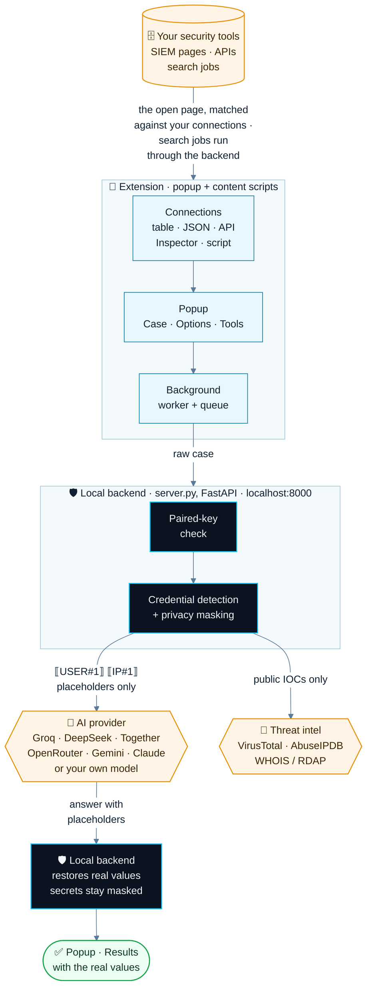
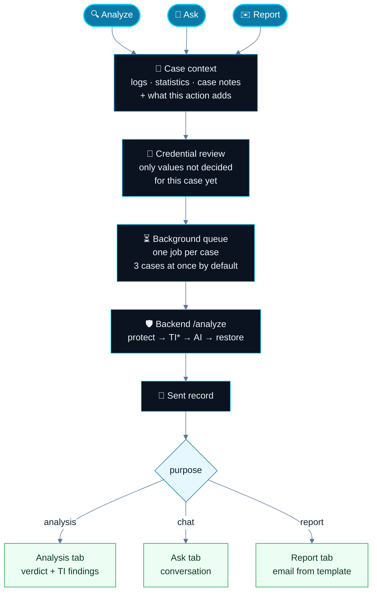
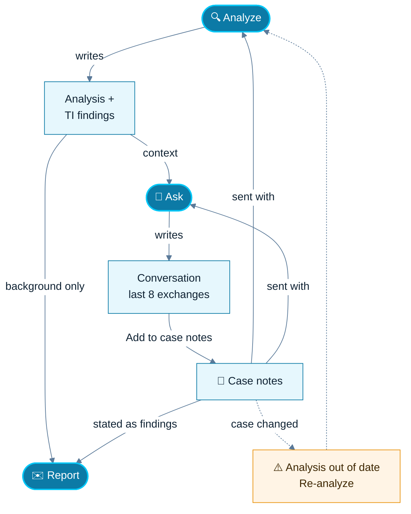
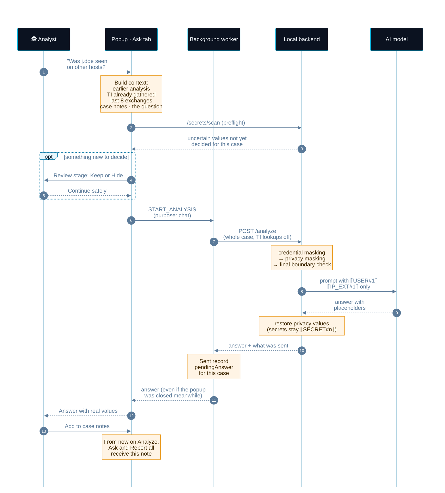
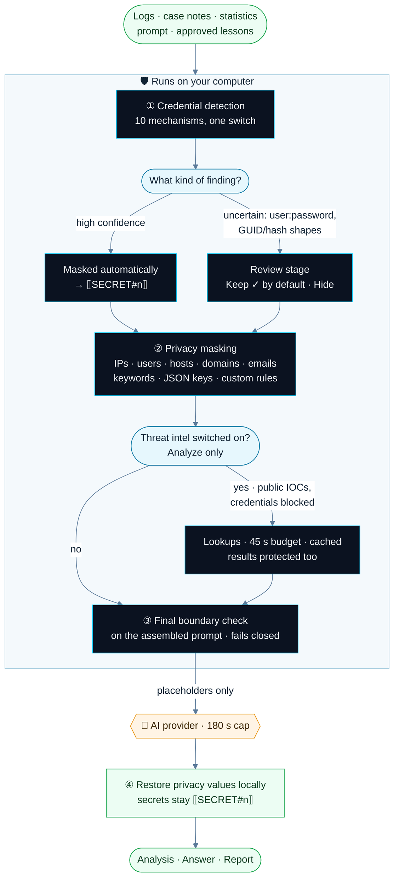
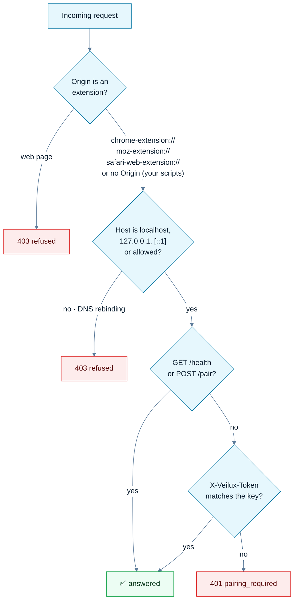
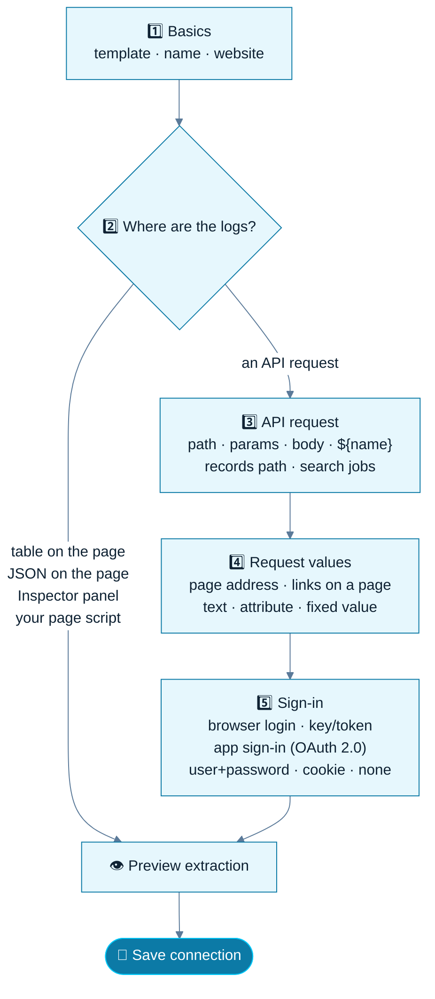
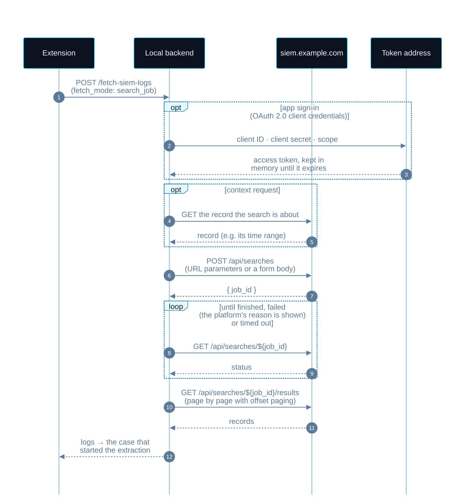
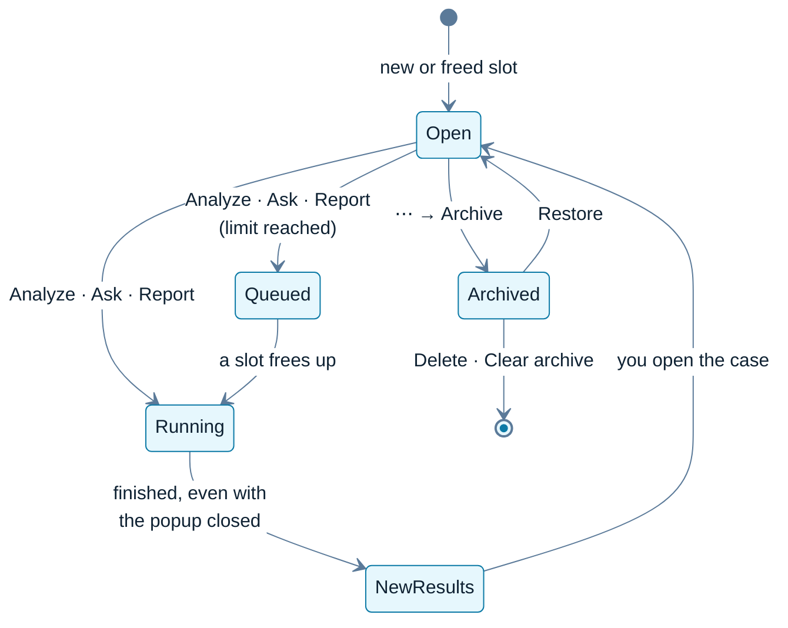

# VEILUX: detailed diagrams

The [README](../README.md) keeps three overview diagrams. This page holds the detailed ones: every component, branch and time limit. Each section links back to the README section it expands.

- [1. Full data flow](#1-full-data-flow)
- [2. How Analyze, Ask and Report feed each other](#2-how-analyze-ask-and-report-feed-each-other)
- [3. A question, step by step](#3-a-question-step-by-step)
- [4. Full protection pipeline](#4-full-protection-pipeline)
- [5. Backend access check](#5-backend-access-check)
- [6. Connection editor flow](#6-connection-editor-flow)
- [7. Search-job sequence](#7-search-job-sequence)
- [8. Case lifecycle](#8-case-lifecycle)

## 1. Full data flow

Expands [How it works](../README.md#how-it-works). The extension is made of connections (the readers), the popup and a background worker; the backend checks the paired key, protects the case, sends only public indicators to threat intelligence and only placeholders to the AI provider, and restores the answer locally.

## 2. How Analyze, Ask and Report feed each other

Expands [Analyze, Ask, Report](../README.md#analyze-ask-report-one-case-three-actions). All three actions go through the same protected request; its result is routed to the tab that matches its purpose.

\* Threat-intelligence lookups run for **Analyze** only; Ask and Report reuse the results already in the case.

What each action writes, and what the others read from it:

## 3. A question, step by step

What happens between typing a question in the **Ask** tab and reading the answer with the real values.

- **One job per case, several cases at once.** Closing the popup does not cancel the request; the answer is shown the next time the case is opened.
- **Review once per case.** The preflight (`/secrets/scan`) only shows values not yet decided for this case.
- **Every action is recorded** in the **Sent** tab with its purpose: Analysis, Ask or Email report.

## 4. Full protection pipeline

Expands [Sanitization controls and review](../README.md#sanitization-controls-and-review), including the threat-intelligence branch and the time limits.

## 5. Backend access check

Expands [Pair the extension with the backend](../README.md#3-pair-the-extension-with-the-backend). Every incoming request passes these checks in order.

See [SECURITY.md](../SECURITY.md) for the key file's permissions, pairing limits and network use.

## 6. Connection editor flow

Expands [Configure your connections](../README.md#5-configure-your-connections). Steps 3 to 5 appear only for API connections. The [connection setup guide](CONNECTOR_SETUP.md) covers every field.

## 7. Search-job sequence

The [search-job example](../README.md#example-an-api-with-search-jobs) for a fictional SIEM at `https://siem.example.com`. Search jobs always run through the local backend.

## 8. Case lifecycle

Expands [Cases](../README.md#cases): how a case moves between open, queued, running, new results and archived.

